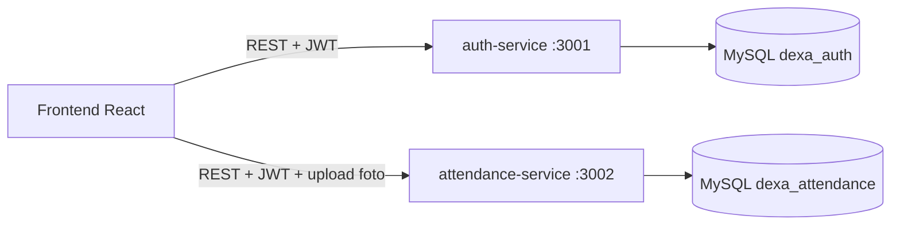

# Dexa Attendance

Aplikasi absensi WFH karyawan dan monitoring oleh admin HRD. Dibuat untuk Fullstack Web Technical Test Dexa Group.

## Fitur

**Karyawan**
- Login dengan JWT
- Absen WFH: tanggal dan waktu tercatat otomatis (WIB), wajib unggah foto bukti
- Satu kali absen per hari
- Riwayat absen pribadi

**Admin HRD**
- Master data karyawan: tambah, ubah, aktifkan/nonaktifkan, pencarian
- Monitoring absensi (view only): filter tanggal dan nama, pagination, pratinjau foto

## Tech stack

| Bagian | Teknologi |
|---|---|
| Backend | NestJS (TypeScript), TypeORM |
| Database | MySQL 8 |
| Frontend | React, TypeScript, Vite, Tailwind CSS, React Router |
| Auth | JWT (passport-jwt), bcrypt, RBAC dua role |
| Infrastruktur | Docker Compose, nginx |

## Arsitektur



Aplikasi dipisah menjadi dua service yang berdiri sendiri:

- **auth-service**: login, penerbitan JWT, dan data master karyawan.
- **attendance-service**: submit absen, penyimpanan foto, dan daftar absensi.

Keputusan desain:

1. **Satu database per service.** `dexa_auth` dan `dexa_attendance` terpisah. Tidak ada join atau foreign key lintas database; tabel `attendances` hanya menyimpan `employeeId` sebagai angka biasa.
2. **Komunikasi stateless lewat JWT.** auth-service menerbitkan token berisi id, nama, email, dan role. attendance-service memverifikasi token dengan `JWT_SECRET` yang sama, tanpa memanggil auth-service di setiap request. Nama dan email karyawan disimpan sebagai snapshot di tabel absensi.
3. **Soft delete karyawan.** "Hapus" berarti menonaktifkan (`isActive = false`), supaya riwayat absensi di service lain tidak menjadi yatim.
4. **Konfigurasi per service** lewat environment variable.
5. **RBAC.** `EMPLOYEE` hanya bisa absen dan melihat riwayat sendiri; `ADMIN_HRD` mengelola karyawan dan melihat semua absensi (tanpa akses mengubah absensi).

## Menjalankan dengan Docker

Prasyarat: Docker Desktop.

```bash
docker compose up -d --build
```

| Layanan | URL |
|---|---|
| Frontend | http://localhost:8080 |
| auth-service | http://localhost:3001 |
| attendance-service | http://localhost:3002 |
| MySQL | localhost:3306 |

Akun admin HRD default (dibuat otomatis saat pertama kali jalan):

- Email: `admin@dexa.test`
- Password: `Admin123!`

Akun karyawan dibuat oleh admin lewat menu **Karyawan**. Untuk mencoba alur karyawan, buat satu karyawan, lalu login dengan akun itu.

Konfigurasi bisa diubah lewat file `.env` di root (lihat `.env.example`). Untuk mengulang dari nol (menghapus semua data):

```bash
docker compose down -v
```

## Menjalankan tanpa Docker (development)

Prasyarat: Node.js 20 atau lebih baru dan Docker (hanya untuk MySQL).

```bash
docker compose up -d mysql

# auth-service
cd auth-service
cp .env.example .env
npm install
npm run start:dev

# attendance-service (terminal baru)
cd attendance-service
cp .env.example .env
npm install
npm run start:dev

# frontend (terminal baru)
cd frontend
cp .env.example .env
npm install
npm run dev
```

Frontend berjalan di http://localhost:5173. `JWT_SECRET` di kedua service **harus sama**.

## Variabel environment

| Variabel | Service | Keterangan |
|---|---|---|
| `PORT` | auth, attendance | Port service |
| `DB_HOST`, `DB_PORT`, `DB_USER`, `DB_PASSWORD`, `DB_NAME` | auth, attendance | Koneksi MySQL |
| `JWT_SECRET` | auth, attendance | Secret penandatanganan JWT (harus sama) |
| `JWT_EXPIRES_IN` | auth | Masa berlaku token, default `1d` |
| `ADMIN_EMAIL`, `ADMIN_PASSWORD` | auth | Akun admin awal |
| `UPLOAD_DIR` | attendance | Folder penyimpanan foto |
| `VITE_AUTH_URL`, `VITE_ATTENDANCE_URL` | frontend | Alamat API (saat build) |

## Endpoint API

**auth-service (:3001)**

| Method | Path | Akses | Keterangan |
|---|---|---|---|
| POST | `/auth/login` | Publik | Login, mengembalikan `accessToken` |
| GET | `/auth/me` | Terautentikasi | Data user dari token |
| POST | `/employees` | ADMIN_HRD | Tambah karyawan |
| GET | `/employees?search=` | ADMIN_HRD | Daftar karyawan |
| GET | `/employees/:id` | ADMIN_HRD | Detail karyawan |
| PATCH | `/employees/:id` | ADMIN_HRD | Ubah data, termasuk `isActive` |
| DELETE | `/employees/:id` | ADMIN_HRD | Nonaktifkan karyawan |

**attendance-service (:3002)**

| Method | Path | Akses | Keterangan |
|---|---|---|---|
| POST | `/attendances` | EMPLOYEE | Submit absen (`multipart/form-data`: `photo`, `notes`) |
| GET | `/attendances/me` | EMPLOYEE | Riwayat absen sendiri |
| GET | `/attendances` | ADMIN_HRD | Semua absensi. Query: `from`, `to`, `name`, `employeeId`, `page`, `limit` |
| GET | `/uploads/:file` | Publik | File foto (nama acak UUID) |

Validasi upload: JPG, PNG, atau WEBP, maksimal 5 MB. Satu karyawan hanya bisa absen sekali per hari (tanggal dihitung menurut WIB).

## Struktur proyek

```
├── auth-service/          NestJS: login, JWT, CRUD karyawan
├── attendance-service/    NestJS: absensi dan upload foto
├── frontend/              React + Vite + Tailwind
├── docker/init.sql        Pembuatan dua database
├── docker-compose.yml
└── .env.example
```

## Keterbatasan dan pengembangan lanjutan

- `synchronize: true` pada TypeORM dipakai demi kemudahan setup. Untuk production gunakan migration.
- Karyawan yang dinonaktifkan masih bisa memakai token lamanya sampai kedaluwarsa. Solusi: token lebih pendek disertai refresh token, atau pengecekan status ke auth-service.
- Foto disimpan di disk lokal (volume Docker). Untuk production, gunakan object storage dengan signed URL.
- Belum ada rate limiting pada endpoint login, dan CORS masih terbuka untuk semua origin.
- Belum ada automated test.
- Kredensial default hanya untuk keperluan demo.